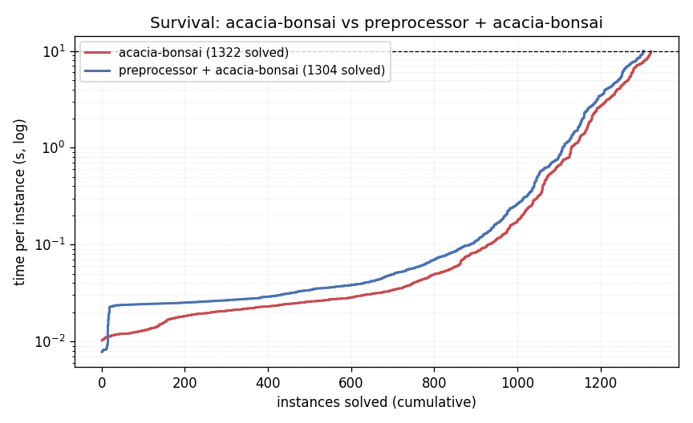

# acacia-bonsai vs preprocessor + acacia-bonsai

This benchmark snapshot needs regeneration before relying on its numbers:

```sh
scripts/benchgraph.py \
    --corpus ../benchmarks/tlsf \
    --tlsfcompose build-oxidd/tlsfcompose \
    --solver ../acacia-bonsai/build_best_decomp_mona/src/acacia-bonsai \
    --out BENCHGRAPH.md \
    --data benchgraph.tsv \
    --timeout 10 --mem-gb 6
```

Use `--from-data benchgraph.tsv` to re-render. For per-instance variants, use
`--data docs/benchgraph/RUN.tsv` and repeated `--compose-extra-arg` options.

<!-- BENCHGRAPH:PREPROCESSOR START (generated by scripts/benchgraph.py) -->
## acacia-bonsai vs preprocessor + acacia-bonsai (`scripts/benchgraph.py`)
The preprocessor uses `--split`, one persistent OxiDD residual-solving phase, and external residual merging. Trusted exact/UNDER controller routes and OVER UNREAL routes finish in process; acacia-bonsai handles remaining exact clusters. Each (engine, spec) pair has the same timeout.

Run: 2026-06-26 22:23 UTC, commit `cc1ff25`.

- Corpus `../benchmarks/tlsf` (2545 specs); timeout **10s**, 6 GB/run (systemd cgroup hard cap), sequential.
- acacia-bonsai: `tlsf2tlsf --basic` + `tlsf2ltl --format ltlxba` + `acacia-bonsai -F ... -i ... -o ... -s ...`
- preprocessor + acacia-bonsai: `scripts/solve.sh --backend acacia --solver ...`
- Specs completed without an external residual solver: **454/2545 = 17.8%**.

### Solved within timeout
| engine | solved | only this engine |
|---|--:|--:|
| acacia-bonsai | 1322/2545 | 60 |
| preprocessor + acacia-bonsai | 1304/2545 | 42 |

- Both: 1262; neither: 1181. **Net gain from the preprocessor: -18** (42 won, 60 lost).
- Preprocessor-only solves by family: selection-ltl-2025×36, extracted-benchmarks×2, specs×1, parametric×1, parametric×1, Lights2_f1477cc5×1.

For the 760 specs where both produced controllers, speedup `acacia/preproc` was median ×0.84, geomean ×0.69 (faster 142, slower 618); aggregate wall ×0.86.


<!-- BENCHGRAPH:PREPROCESSOR END -->

## Diagnosis

The preprocessor was slower overall, with zero verdict disagreements among the
1262 definitive verdict pairs. It left one external cluster on **2062/2545**
specs, with a median residual/full node ratio of **1.0**: decomposition, routing,
and merging often added overhead without shrinking Acacia's formula.

Only **454/2545** specs finished locally. Unsupported residuals were mostly
liveness-heavy, especially `liveness: nested_unsupported`. Coverage is useful
when it shrinks or removes these residuals. Local solving can also be expensive:
large `shift_pb_*` instances create many OxiDD clusters and lose by orders of
magnitude. Prioritize residual reduction and useful fragment coverage, then
routing cutoffs for expensive local plans; wrapper micro-optimization comes later.
